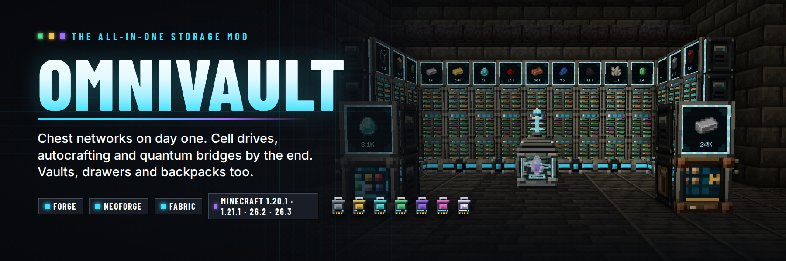

# OmniVault

**One mod for every storage need.** A channel-free digital storage network with drives, cells, terminals,
buses and autocrafting; tiered vaults, drawers, linked (ender) vaults and backpacks with upgrades; and a
progression that starts with a Tom's-Simple-Storage-style chest network on day one and ends with
quantum bridges between dimensions. Every block is a hand-built 3D model.

OmniVault is the successor of **Simple Terminals**: worlds that used its Crafting Terminal keep it.



## Features

| Area | Highlights |
| --- | --- |
| [Early game](docs/PROGRESSION.md) | Storage Hub + Inventory Cable: every chest the cable touches in one terminal. Vanilla materials, no power. |
| [Storage network](docs/NETWORK.md) | Nexus Core, dyeable cables, Cell Drives with item and fluid cells from 4K to Singularity (2.1 billion items), storage and crafting terminals with search, sorting, fluids and JEI transfer, import/export/storage buses, Network Port, Destructor, Constructor, Signal Emitter, Storage Monitor, wireless and quantum wireless terminals, Quantum Bridges between dimensions, optional Forge Energy. No channels. |
| [Autocrafting](docs/AUTOCRAFTING.md) | Crafting and processing patterns, Pattern Providers for any mod's machines, Assemblers and Quantum Assemblers, Crafting Processors, a planner with sub-crafts, reservations and a live status screen. |
| [Physical storage](docs/STORAGE.md) | Six tiers of vaults (45–162 slots) with in-place upgrade kits, 1×1/1×2/2×2 drawers, compacting drawers and drawer controllers, Linked Vaults and Pouches, Trash Can, Relocators. |
| [Backpacks](docs/BACKPACKS.md) | Six tiers (27–120 slots), wearable and placeable, nine upgrades: pickup, magnet, void, feeding, restock, compacting, crafting, everlasting and deposit. |
| [Configuration](docs/CONFIG.md) | One commented `omnivault-common.toml`. |

## Supported versions

| Minecraft | Loader | Java | Also install |
| --- | --- | --- | --- |
| 26.3 | NeoForge 26.3.0.100+ | 25 | Nothing (JEI optional) |
| 26.3 | Fabric Loader 0.20.1+ | 25 | [Fabric API](https://www.curseforge.com/minecraft/mc-mods/fabric-api) |
| 26.2 | NeoForge 26.2.0.93+ | 25 | Nothing (JEI optional) |
| 26.2 | Fabric Loader 0.20.1+ | 25 | [Fabric API](https://www.curseforge.com/minecraft/mc-mods/fabric-api) |
| 1.21.1 | NeoForge 21.1.80+ | 21 | Nothing (JEI optional) |
| 1.21.1 | Fabric Loader 0.16.14+ | 21 | [Fabric API](https://www.curseforge.com/minecraft/mc-mods/fabric-api) |
| 1.20.1 | Forge 47.4.28+ | 17 | Nothing (JEI optional) |
| 1.20.1 | Fabric Loader 0.20.1+ | 17 | [Fabric API](https://www.curseforge.com/minecraft/mc-mods/fabric-api) |

Every version and loader has the same content. On Fabric, JEI is optional too, and networks that need power use
Team Reborn Energy. Each Minecraft version is a MultiLoader workspace (`common` + loader modules) in its own folder.
Install on both the server and every client.

## Building

Each Minecraft version is a separate MultiLoader Gradle workspace with its own wrapper. These are the only supported
targets (the NightBeam convention): 8 jars per release, all with the same version.

| Minecraft | Loaders | Java | Folder |
| --- | --- | --- | --- |
| 1.20.1 | Forge, Fabric | 17 bytecode (build on 21) | `1.20.1/{common,forge,fabric}` |
| 1.21.1 | NeoForge, Fabric | 21 | `1.21.1/{common,neoforge,fabric}` |
| 26.2 | NeoForge, Fabric | 25 | `26.2/{common,neoforge,fabric}` |
| 26.3 | NeoForge, Fabric | 25 | `26.3/{common,neoforge,fabric}` |

```bash
./gradlew buildAll             # every workspace, then the 8 loader jars into releases/
cd 1.20.1 && ./gradlew build   # Gradle on Java 21 (Java 17 toolchain)
cd 1.21.1 && ./gradlew build   # Java 21
cd 26.3 && ./gradlew build     # Java 25 (the same for 26.2)
```

The root build hands the 26.x workspaces `JAVA_HOME_25_X64` (or `-Pjava25Home=<jdk>`) and the others
`JAVA_HOME_21_X64` (or `-Pjava21Home=<jdk>`); without them each workspace uses the current `JAVA_HOME`.
Jars land in `<minecraft>/<loader>/build/libs/omnivault-<loader>-<minecraft>-<version>.jar`, for example
`1.21.1/neoforge/build/libs/omnivault-neoforge-1.21.1-2.0.4.jar`. Every workspace's `gradle.properties` carries the
same `version=` (`./gradlew checkVersions`; set it with `./gradlew syncVersion -PmodVersion=x.y.z`).
`python3 scripts/check_targets.py workspaces` checks the targets, the shared version and the metadata ranges.

## Testing

```bash
cd 1.21.1 && ./gradlew :neoforge:runGameTestServer   # boots a NeoForge dedicated server and runs every GameTest
cd 1.21.1 && ./gradlew :fabric:runGametest            # the same GameTests, plus Fabric transfer tests, on Fabric
cd 1.20.1 && ./gradlew :forge:runGameTestServer      # on 1.20.1 the first loader is Forge
python3 -m unittest discover -s tests                 # resource and release-guard checks (repository root)
node --test scripts/*.test.mjs                        # same-day guard tests
python3 tools/assets/build_lang.py --check            # en_us.json matches the lang fragments
```

The GameTests build real networks, vaults, drawers, backpacks and autocrafting setups in a world and check the
results, from cell capacities to a furnace smelting through a Pattern Provider and a drive in the Nether joined
through a Quantum Bridge. The same tests run on every version and loader. `tools/qa/` drives a dev server and a
headless client (`QA_MC=26.2 QA_LOADER=fabric`, for example) for in-game checks and screenshots.

## Releasing

CI (`.github/workflows/ci.yml`) builds all 8 jars and runs the GameTests and the checks above on every push to `main`
that touches the build. Publishing to CurseForge is `.github/workflows/publish.yml`, run by hand
(`version`, `dry_run`) or by a `v*.*.*` tag; it never runs on a plain push. It refuses a second release of the mod on
the same day (Africa/Tunis), builds the jars from source, fails unless exactly the 8 jars are found, and takes the
release notes from this version's section of `CHANGELOG.md`. It needs the secrets `CURSEFORGE_TOKEN`
(upload token) and `CURSEFORGE_API_KEY` (Core API key) and the variable `CURSEFORGE_ID`. NightBeam publishes to
CurseForge only; the Modrinth page stays up but gets no new versions.

## Project layout

```
1.21.1/         # the reference workspace: art and lang are generated here
├── common/     # gameplay, menus, screens, renderers (vanilla APIs only), plus the shared GameTests
├── fabric/     # Fabric glue: Transfer API storages, payloads, mixins, client setup
└── neoforge/   # NeoForge glue: capabilities, payloads, events, client setup
1.20.1/         # the same layout with forge/ in place of neoforge/
26.2/, 26.3/    # the same layout
build.gradle    # root aggregator: buildAll, dist (the 8 jars into releases/), checkVersions, syncVersion
scripts/        # release_guard.py (jar checks), check_targets.py (the 8 targets), same_day_guard.mjs (publish)
tools/
├── assets/     # generators for every texture, model, blockstate, recipe and loot table; offline model renderer
├── lang/       # lang fragments merged into en_us.json
├── port/       # derive each other version's resources from the 1.21.1 ones
└── qa/         # dev server / Xvfb client automation
marketing/      # CurseForge listing copy and artwork
docs/           # player guides and architecture notes
```

See [docs/ARCHITECTURE.md](docs/ARCHITECTURE.md) for how the code is organised.

## Contributing

See [CONTRIBUTING.md](CONTRIBUTING.md) and the [Code of Conduct](CODE_OF_CONDUCT.md).

## Security

See [.github/SECURITY.md](.github/SECURITY.md).

## License

Licensed under the [Apache License 2.0](LICENSE).
