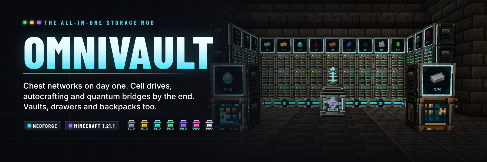

# OmniVault

**One mod for every storage need.** A channel-free digital storage network with drives, cells, terminals,
buses and autocrafting; tiered vaults, drawers, linked (ender) vaults and backpacks with upgrades; and a
progression that starts with a Tom's-Simple-Storage-style chest network on day one and ends with
quantum bridges between dimensions. Every block is a hand-built 3D model.

OmniVault is the successor of **Simple Terminals**: worlds that used its Crafting Terminal keep it.



## Features

| Area | Highlights |
| --- | --- |
| [Early game](docs/PROGRESSION.md) | Storage Hub + Inventory Cable: every chest the cable touches in one terminal. Vanilla materials, no power. |
| [Storage network](docs/NETWORK.md) | Nexus Core, dyeable cables, Cell Drives with item and fluid cells from 4K to Singularity (2.1 billion items), storage and crafting terminals with search, sorting, fluids and JEI transfer, import/export/storage buses, Network Port, Destructor, Constructor, Signal Emitter, Storage Monitor, wireless and quantum wireless terminals, Quantum Bridges between dimensions, optional Forge Energy. No channels. |
| [Autocrafting](docs/AUTOCRAFTING.md) | Crafting and processing patterns, Pattern Providers for any mod's machines, Assemblers and Quantum Assemblers, Crafting Processors, a planner with sub-crafts, reservations and a live status screen. |
| [Physical storage](docs/STORAGE.md) | Six tiers of vaults (45–162 slots) with in-place upgrade kits, 1×1/1×2/2×2 drawers, compacting drawers and drawer controllers, Linked Vaults and Pouches, Trash Can, Relocators. |
| [Backpacks](docs/BACKPACKS.md) | Six tiers (27–120 slots), wearable and placeable, nine upgrades: pickup, magnet, void, feeding, restock, compacting, crafting, everlasting and deposit. |
| [Configuration](docs/CONFIG.md) | One commented `omnivault-common.toml`. |

## Supported versions

| Minecraft | Loader | Java | Also install |
| --- | --- | --- | --- |
| 1.21.1 | NeoForge 21.1.80+ | 21 | Nothing (JEI optional) |

The project uses the MultiLoader layout (`common` + loader modules) so Fabric and other Minecraft versions can follow.
Install on both the server and every client.

## Building

```bash
cd 1.21.1
./gradlew build
```

The jar is written to `1.21.1/neoforge/build/libs/omnivault-1.21.1-neoforge-<version>.jar`.

## Testing

```bash
cd 1.21.1 && ./gradlew :neoforge:runGameTestServer   # boots a dedicated server and runs every GameTest
python3 -m unittest discover -s tests                 # resource and release-guard checks (repository root)
python3 tools/assets/build_lang.py --check            # en_us.json matches the lang fragments
```

The GameTests build real networks, vaults, drawers, backpacks and autocrafting setups in a world and check the
results, from cell capacities to a furnace smelting through a Pattern Provider and a drive in the Nether joined
through a Quantum Bridge. `tools/qa/` drives a dev server and a headless client for in-game checks and screenshots.

## Project layout

```
1.21.1/
├── common/     # gameplay, menus, screens, renderers (vanilla APIs only)
└── neoforge/   # NeoForge glue, plus src/gametest (not shipped)
tools/
├── assets/     # generators for every texture, model, blockstate, recipe and loot table; offline model renderer
├── lang/       # lang fragments merged into en_us.json
└── qa/         # dev server / Xvfb client automation
marketing/      # CurseForge/Modrinth listing copy and artwork
docs/           # player guides and architecture notes
```

See [docs/ARCHITECTURE.md](docs/ARCHITECTURE.md) for how the code is organised.

## Contributing

See [CONTRIBUTING.md](CONTRIBUTING.md) and the [Code of Conduct](CODE_OF_CONDUCT.md).

## Security

See [.github/SECURITY.md](.github/SECURITY.md).

## License

Licensed under the [Apache License 2.0](LICENSE).
